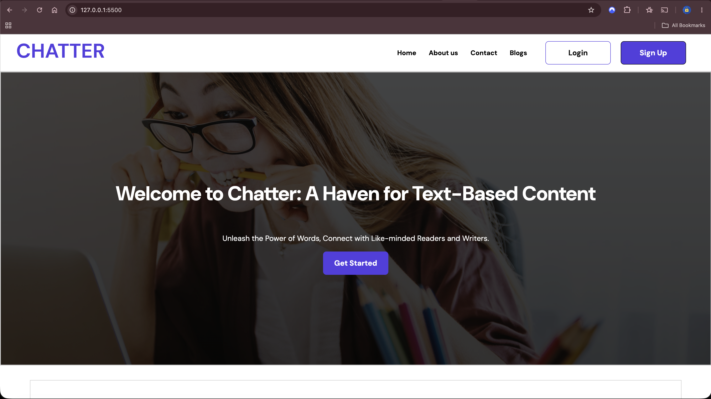

# Chatter_website
# Chatter

A responsive landing page for **Chatter**, a blogging platform for readers and writers. This project is a pixel-faithful conversion of a Figma design into semantic HTML and modern CSS.

🎨 **Figma design:** [View the design on Figma](https://www.figma.com/design/TXzuoMAwGEIfWcAq0HbBNY/purposed?node-id=48-37&t=56gQ5pYZ4wonbGXz-0)
🌐 **Live site:** [View the live site](https://chatterwebsite.vercel.app/)



## Table of Contents

- [About the Project](#about-the-project)
- [Features](#features)
- [Built With](#built-with)
- [Project Structure](#project-structure)
- [Getting Started](#getting-started)
- [Responsive Breakpoints](#responsive-breakpoints)
- [What I Learned](#what-i-learned)
- [Author](#author)

## About the Project

Chatter is a multi-functional platform where authors and readers can share and discover text-based content. This repository contains the marketing landing page, built from scratch with HTML and CSS only, with no frameworks or libraries.

The goal of the project was to practise translating a Figma design into clean, accessible, responsive code.

## Features

- Fully responsive layout for desktop, tablet and mobile
- Hamburger navigation menu built with the native HTML **Popover API**, so it needs no JavaScript
- Hero, About, "Why join Chatter", Testimonial, Call-to-action and Footer sections
- Consistent design tokens (fonts and weights) using CSS custom properties
- Clean, nested CSS using native CSS nesting

## Built With

- **HTML5**: semantic markup (`header`, `nav`, `main`, `section`, `footer`)
- **CSS3**: Flexbox, Grid, custom properties, native CSS nesting, media queries
- **Google Fonts**: [DM Sans](https://fonts.google.com/specimen/DM+Sans)
- **Figma**: design and asset export

## Project Structure

```
chatter/
├── index.html
├── css/
│   └── styles.css
├── assets/
│   ├── icons/
│   └── images/
└── README.md
```

## Getting Started

No build step is needed.

1. **Clone the repository**
   ```bash
   git clone https://github.com/SiliasOdion809/Chatter_website.git
   ```
2. **Open the project folder**
   ```bash
   cd Chatter_website
   ```
3. **Open `index.html`** in your browser, or use a local server such as the VS Code *Live Server* extension.

## Responsive Breakpoints

| Device | Breakpoint | Layout changes |
| --- | --- | --- |
| Desktop | Above 1024px | Full multi-column layout with inline navigation |
| Small laptop / large tablet | 769px to 1024px | Fluid widths, hamburger menu |
| Tablet | Up to 768px | Sections stack vertically, 2-column feature cards |
| Mobile | Up to 440px | Single-column layout, reduced type sizes |

## What I Learned

- Converting a Figma design into pixel-accurate HTML and CSS
- Replacing fixed pixel widths with fluid layouts
- Writing media queries and handling CSS specificity in nested styles
- Building an accessible mobile menu with the Popover API

## Author

**Silias Adodo**

- GitHub: [@SiliasOdion809](https://github.com/SiliasOdion809)

## Acknowledgements

Design by the Chatter Figma design team. Fonts by Google Fonts.